# SpectraWeb - RF Spectrum Scan Management System

SpectraWeb is a web application for recording and managing RF spectrum analyzer measurements. For each sweep it stores the frequency range, peak signal, noise floor, the device that was used and where the scan was taken, so that measurements can be searched and compared later instead of being lost in notebooks or screenshots. Each scan also has a details page with a spectrum plot showing the peak.


## Prerequisites

Before running the project make sure you have the following installed:

- Node.js (v18 or newer)
- MySQL Server 8 (MySQL Workbench is optional)
- Git

## Setup Instructions

### 1. Clone the repository

```bash
git clone https://github.com/sasiruyasith/spectrawe.git
cd spectrawe
```

### 2. Backend configuration

```bash
cd backend
npm install
```

Copy `.env.example` to `.env` and fill in your MySQL details:

```
PORT=5000
DB_HOST=localhost
DB_PORT=3306
DB_USER=root
DB_PASSWORD=your_mysql_password
DB_NAME=spectraweb
JWT_SECRET=some_long_random_string
CLIENT_URL=http://localhost:5173
```

### 3. Create the database and sample data

```bash
npm run setup
```

This creates the `spectraweb` database, the tables and some sample users, devices and scans. Running it again will reset everything back to the sample data.

### 4. Frontend configuration

Open a new terminal:

```bash
cd frontend
npm install
```

## Running the Application

Start the backend (from the `backend` folder):

```bash
npm run dev
```

The API runs on http://localhost:5000. You can check that it is connected to the database at http://localhost:5000/api/health

Start the frontend (from the `frontend` folder):

```bash
npm run dev
```

Then open http://localhost:5173 in the browser.

## Default Login Credentials

| Role | Email | Password |
|------|-------|----------|
| Admin | admin@spectraweb.lk | password123 |
| Analyst | analyst@spectraweb.lk | password123 |
| Viewer | viewer@spectraweb.lk | password123 |

- **Admin** - can manage devices and users and edit or delete any scan
- **Analyst** - can add scans and edit or delete only their own scans
- **Viewer** - read only access

New accounts created from the register page get the analyst role. The admin can change roles from the Users page.

## Features

- Login and registration with JWT authentication and bcrypt password hashing
- Role based access (admin, analyst, viewer)
- Dashboard showing total scans, devices, locations, strongest peak and scans per band
- Add, view, edit and delete spectrum scans
- Search scans by title, location or notes
- Filter scans by band (HF, VHF, UHF, SHF) or by device
- Sort by date, peak power, frequency or title
- Spectrum plot on the scan details page with the peak marked
- Device management (a device cannot be deleted while it still has scans)
- User management for the admin
- Validation on both the frontend and the backend with error messages
- Confirmation popup before deleting anything
- Responsive layout for mobile

## Tech Stack

- **Frontend:** React 18, Vite, React Router, Axios, CSS
- **Backend:** Node.js, Express
- **Database:** MySQL 8
- **Authentication:** JSON Web Tokens, bcryptjs

## Database Design

The database has three tables: `users`, `devices` and `scans`.

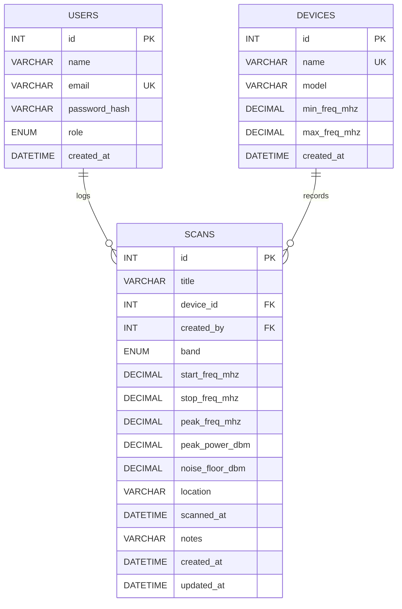

- One device can have many scans. `scans.device_id` references `devices.id` with `ON DELETE RESTRICT`, so a device that is still in use cannot be deleted.
- One user can log many scans. `scans.created_by` references `users.id` with `ON DELETE SET NULL`, so scans are kept even if the user is removed.
- `email` and device `name` are unique.
- CHECK constraints make sure the stop frequency is greater than the start frequency and that the peak frequency is inside the scan range.
- DECIMAL is used for frequency and power values, and ENUM is used for band and role.

The full schema is in `backend/config/schema.sql`.

## API Endpoints

| Method | Endpoint | Access |
|--------|----------|--------|
| POST | /api/auth/register | Public |
| POST | /api/auth/login | Public |
| GET | /api/auth/me | Logged in |
| GET | /api/scans | Logged in |
| GET | /api/scans/stats | Logged in |
| GET | /api/scans/:id | Logged in |
| POST | /api/scans | Admin, Analyst |
| PUT | /api/scans/:id | Admin, Owner |
| DELETE | /api/scans/:id | Admin, Owner |
| GET | /api/devices | Logged in |
| POST | /api/devices | Admin |
| PUT | /api/devices/:id | Admin |
| DELETE | /api/devices/:id | Admin |
| GET | /api/users | Admin |
| PUT | /api/users/:id/role | Admin |
| DELETE | /api/users/:id | Admin |

The scan list supports query parameters: `q` (search), `band`, `device` and `sort` (newest, oldest, power, freq, title).

## Project Files

```
spectrawe/
├── backend/
│   ├── config/          db connection and schema.sql
│   ├── controllers/     auth, scans, devices, users
│   ├── middleware/      auth and validation
│   ├── routes/          api routes
│   ├── setup.js         creates database and sample data
│   └── server.js
├── frontend/
│   ├── public/
│   └── src/
│       ├── components/
│       ├── context/
│       ├── pages/
│       └── utils/
└── docs/screenshots/
```

## Screenshots

**Dashboard**


**Scan list**

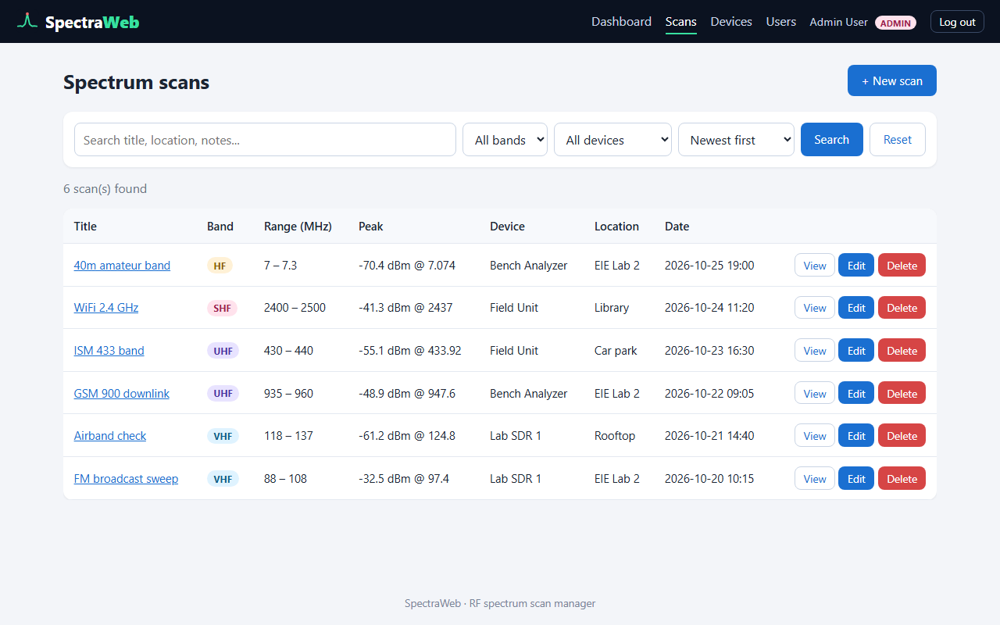

**Filtered by UHF band and sorted by peak power**

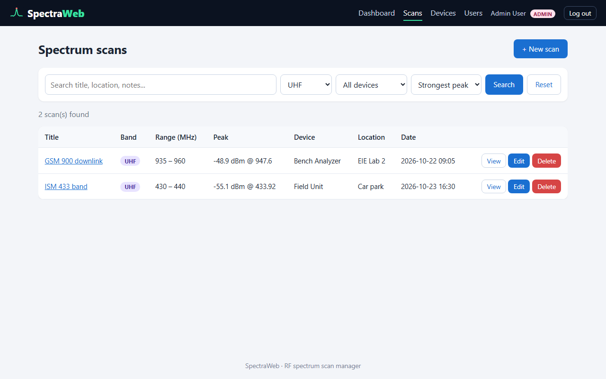

**Scan details**

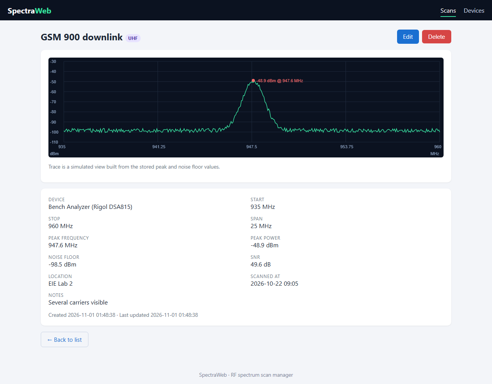

**Add scan**

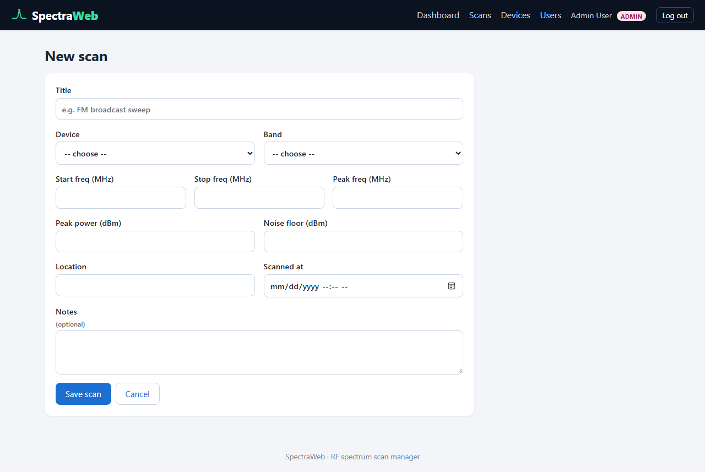

**Validation errors**

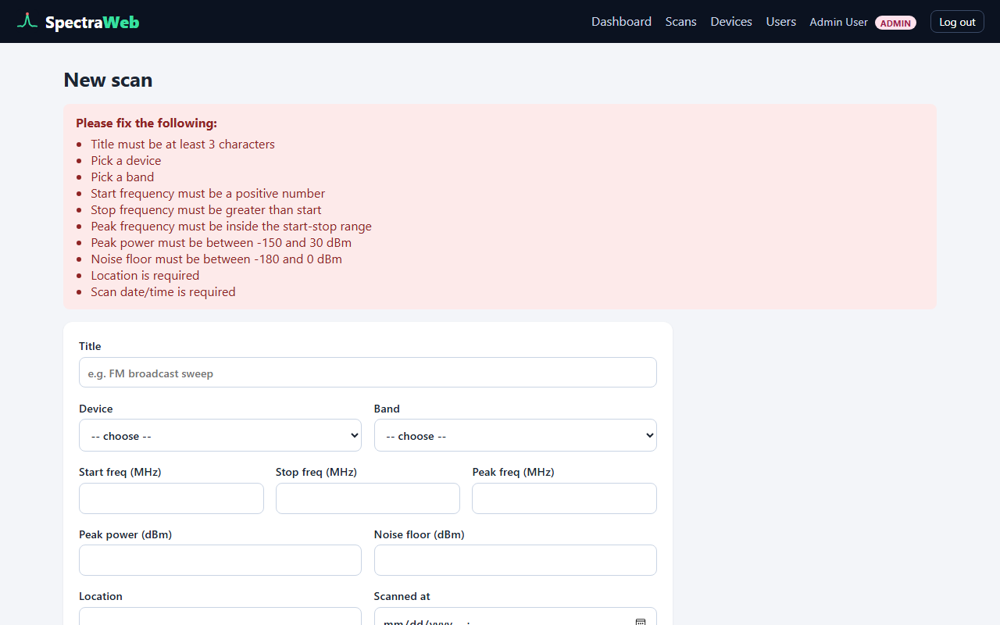

**Edit scan**

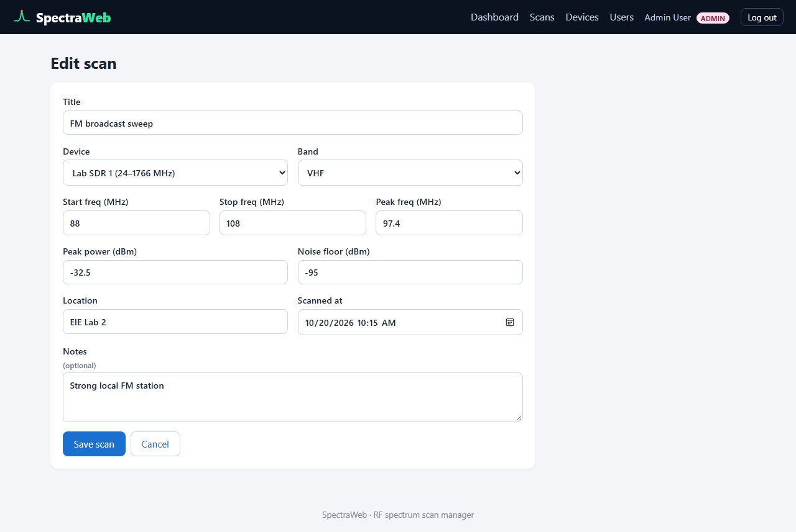

**Delete confirmation**

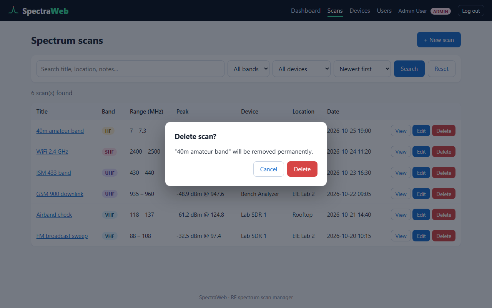

**Devices**

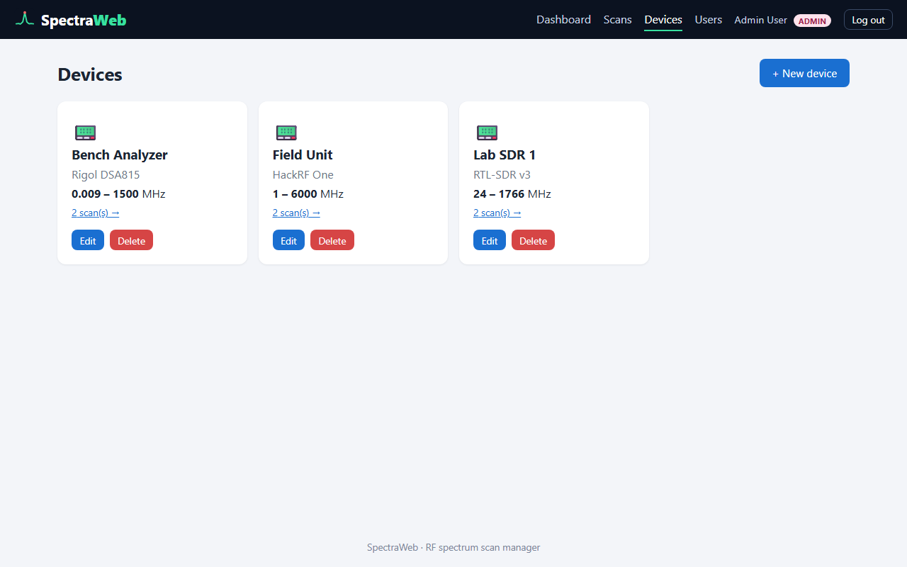

**Users**

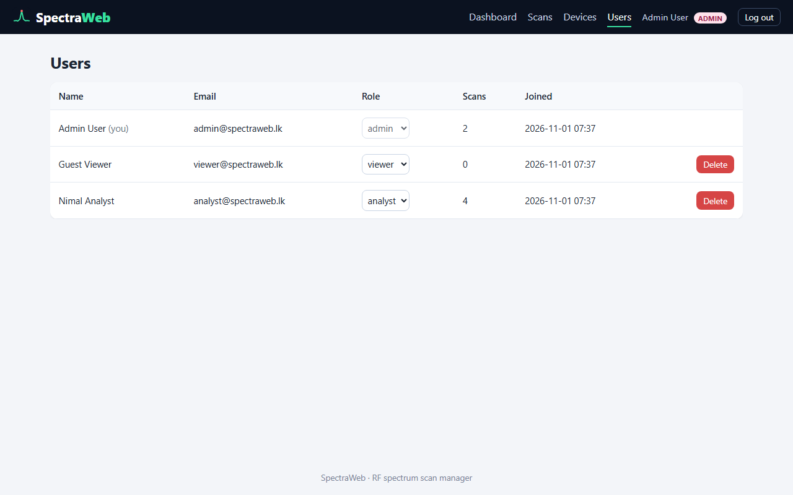

**Login**

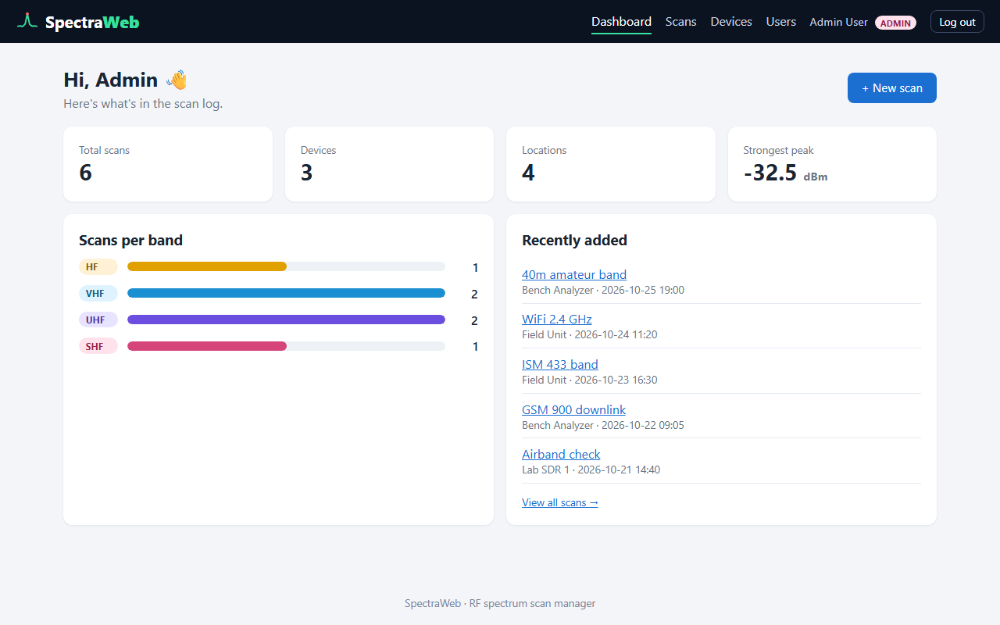

**Mobile view**

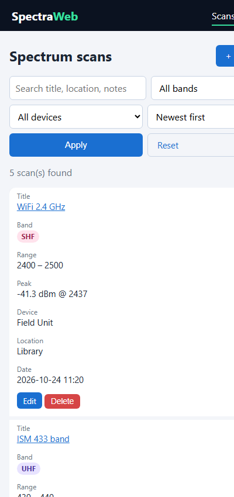 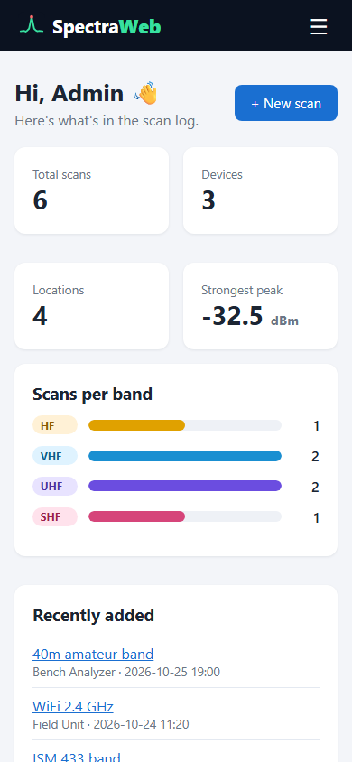

## Troubleshooting

**Access denied for user 'root'** - check `DB_PASSWORD` in `backend/.env`.

**ECONNREFUSED 127.0.0.1:3306** - the MySQL service is not running. Start MySQL80 from Windows Services.

**"Could not reach the server" on the frontend** - make sure the backend is running on port 5000.

**Port 5000 already in use** - change `PORT` in `backend/.env` and add `VITE_API_URL=http://localhost:<port>/api` to a `frontend/.env` file.

**Logged out suddenly** - the login token expires after 8 hours, just log in again.

## Notes

The spectrum plot is generated from the saved peak frequency, peak power and noise floor values. The app stores scan summaries, not raw sweep data.
