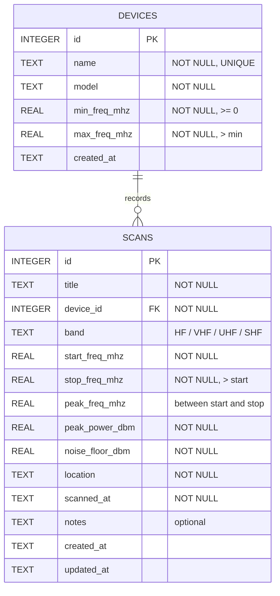
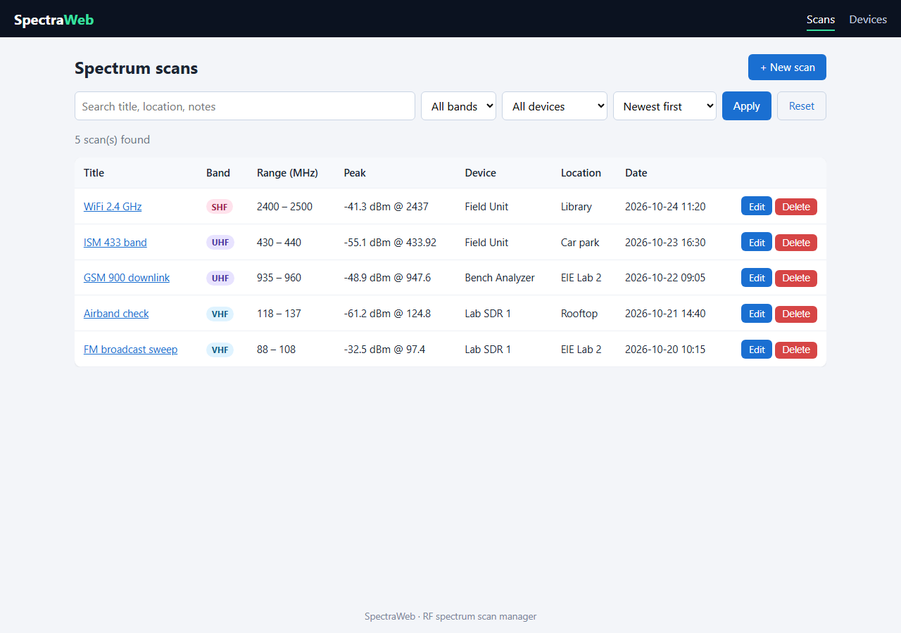

# SpectraWeb

SpectraWeb is a small web app for logging and browsing RF spectrum analyzer scans. For each scan you record the frequency range, the peak signal, the noise floor, where it was taken and which device took it. The app then lists the scans, lets you search, filter and sort them, and draws a spectrum plot on each scan's details page.

Built for the **EE4207 Web Application Development** mini project.

## Features

- **Create**: add scans and devices through forms
- **Read**: list scans, view details with a spectrum plot, **search** (title / location / notes), **filter** (band, device) and **sort** (date, peak power, frequency, title)
- **Update**: edit any scan or device
- **Delete**: asks for confirmation first. A device that still has scans can't be deleted (foreign key `ON DELETE RESTRICT`)
- **Validation**: in the browser (JS) and again on the server, with readable error messages, plus custom 404 and 500 pages
- **Responsive**: works on phones (the table turns into cards on small screens)

## Tech stack

| Layer    | Tech |
|----------|------|
| Backend  | Node.js 22+, Express 4 |
| Views    | EJS templates (server rendered) |
| Database | SQLite, through Node's built-in `node:sqlite` module |
| Frontend | HTML, CSS, vanilla JS (Canvas for the spectrum plot) |

## Setup

Requirements: **Node.js 22.5 or newer** (`node -v`).

```bash
git clone https://github.com/<your-username>/spectraweb.git
cd spectraweb
npm install
npm start
```

Then open http://localhost:3000

On first run the app creates `spectraweb.db` and fills it with a few sample devices and scans. To reset the data, stop the server, delete `spectraweb.db` and start it again.

> Node prints an `ExperimentalWarning` about SQLite on startup. That's expected and can be ignored.

## Project structure

```
spectraweb/
├── app.js              # express setup, routes, error handlers
├── db.js               # sqlite connection, schema, seed data
├── validate.js         # server side validation
├── routes/
│   ├── scans.js        # CRUD + search/filter/sort for scans
│   └── devices.js      # CRUD for devices
├── views/              # EJS templates
│   ├── partials/       # header, footer, error list
│   ├── scans/          # index, show, form
│   └── devices/        # index, form
├── public/
│   ├── css/style.css
│   └── js/main.js      # client validation, delete confirm, spectrum plot
└── docs/screenshots/
```

## Database design (ERD)



- **One-to-many**: one device can record many scans. Each scan belongs to exactly one device.
- `scans.device_id` → `devices.id` is a foreign key with `ON DELETE RESTRICT`, and foreign keys are switched on with `PRAGMA foreign_keys = ON`.
- `CHECK` constraints enforce the frequency rules in the database too (stop > start, peak inside the range, allowed band values).
- An index on `scans.device_id` speeds up the join and the filter by device.

## Routes

| Method | URL | Action |
|--------|-----|--------|
| GET  | `/scans` | list, search, filter, sort |
| GET  | `/scans/new` | new scan form |
| POST | `/scans` | create scan |
| GET  | `/scans/:id` | scan details + plot |
| GET  | `/scans/:id/edit` | edit form |
| POST | `/scans/:id/edit` | update scan |
| POST | `/scans/:id/delete` | delete scan |
| GET  | `/devices` | list devices |
| GET/POST | `/devices/new`, `/devices` | create device |
| GET/POST | `/devices/:id/edit` | update device |
| POST | `/devices/:id/delete` | delete device (blocked if it has scans) |

## Screenshots

**Scan list (search / filter / sort)**


**Scan details with spectrum plot**


**Create scan**


**Edit scan**


**Devices**


**Mobile view**


## Notes

- The spectrum trace on the details page is simulated from the stored peak frequency, peak power and noise floor. The app stores scan summaries, not raw IQ or sweep data.
- AI assistance (Claude) was used while developing this project, which the module allows.
