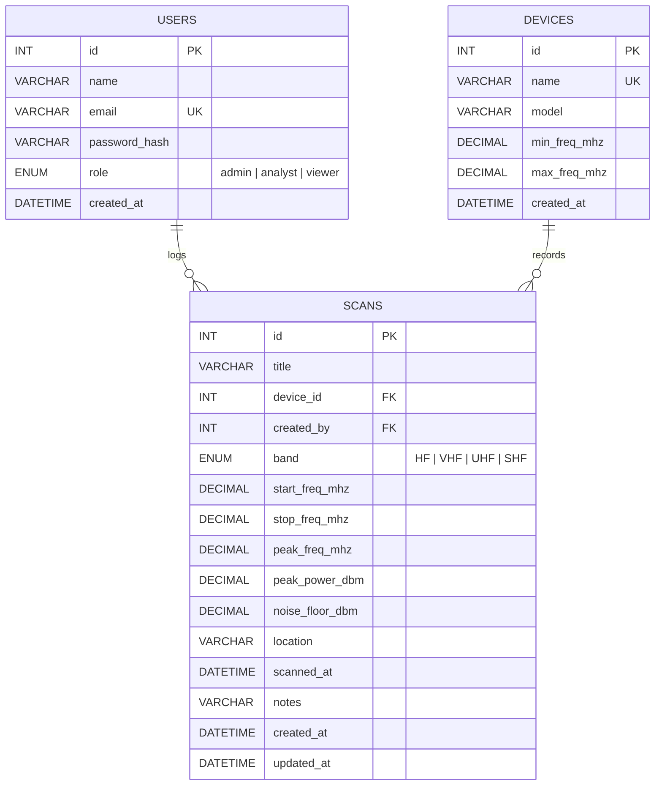

<p align="center">
  
</p>

<h1 align="center">SpectraWeb</h1>

<p align="center">
  <b>RF spectrum scan manager</b><br>
  Log, search and review spectrum analyzer measurements from the lab or the field.
</p>

<p align="center">
  
  
  
  
  
</p>


---

## About

SpectraWeb is a web app for keeping a record of **RF spectrum analyzer scans**. For each scan you can store:

- the frequency range (start and stop), the peak frequency and peak power
- the noise floor
- the band (HF / VHF / UHF / SHF)
- the device that took it, the location and the time

Every scan has a details page with a **spectrum plot** that marks the peak.

Built for the **EE4207 Web Application Development** mini project.

## Features

| | Feature |
|---|---|
| ➕ | **Create**: add scans, devices and user accounts through forms |
| 📋 | **Read**: dashboard with stats, scan list, scan details with spectrum plot |
| 🔎 | **Search / filter / sort**: keyword search, filter by band or device, sort by date, power, frequency or title |
| ✏️ | **Update**: edit scans and devices, and change user roles |
| 🗑️ | **Delete**: a confirmation popup comes up first. Devices that still have scans can't be deleted (FK `RESTRICT`) |
| ✅ | **Validation**: client side (React) and server side (Express middleware) with clear error messages |
| 🔐 | **Auth & roles**: JWT login and bcrypt password hashing, with **admin / analyst / viewer** roles |
| 📱 | **Responsive**: hamburger menu, and tables turn into cards on phones |

### Roles

| Role | Can do |
|------|--------|
| **Admin** | Everything: manage devices and users, and edit or delete any scan |
| **Analyst** | Create scans, and edit or delete **their own** scans |
| **Viewer** | Read only: browse, search and view scans and devices |

New accounts start as **analyst**. An admin can change roles on the Users page.

## Tech stack

| Layer | Tech |
|-------|------|
| Frontend | React 18, Vite, React Router, Axios, plain CSS |
| Backend | Node.js, Express 4, JWT (`jsonwebtoken`), `bcryptjs` |
| Database | MySQL 8 (through `mysql2`) |
| Tools | Git, npm, nodemon, ESLint |

---

## Setup

### Prerequisites

- **Node.js** 18 or newer
- **MySQL Server** 8 running locally (MySQL Workbench is optional but handy)

### 1. Clone

```bash
git clone https://github.com/<your-username>/spectraweb.git
cd spectraweb
```

### 2. Backend

```bash
cd backend
npm install
cp .env.example .env      # on Windows: copy .env.example .env
```

Open `backend/.env` and set your MySQL password and a JWT secret:

```env
DB_USER=root
DB_PASSWORD=your_mysql_password
JWT_SECRET=any_long_random_string
```

Create the database, tables and sample data:

```bash
npm run setup
```

> ⚠️ `npm run setup` **drops and recreates** the SpectraWeb tables. Use it again any time you want to reset the data.

Start the API (runs on **http://localhost:5000**):

```bash
npm run dev
```

Check it's working: http://localhost:5000/api/health should return `{"status":"ok","db":"connected"}`.

### 3. Frontend

In a **second terminal**:

```bash
cd frontend
npm install
npm run dev
```

Open **http://localhost:5173**

### Demo logins

All the demo accounts use the password **`password123`**.

| Role | Email |
|------|-------|
| Admin | `admin@spectraweb.lk` |
| Analyst | `analyst@spectraweb.lk` |
| Viewer | `viewer@spectraweb.lk` |

---

## Database design

### ERD



### Relationships and constraints

- **devices 1 ─ * scans**: `scans.device_id → devices.id`, **ON DELETE RESTRICT** (a device that still has scans can't be removed).
- **users 1 ─ * scans**: `scans.created_by → users.id`, **ON DELETE SET NULL** (when a user is deleted, their scans are kept).
- `UNIQUE` on `users.email` and `devices.name`.
- `CHECK` constraints:
  - `stop_freq_mhz > start_freq_mhz`
  - the peak frequency must lie inside the scan range
  - `max_freq_mhz > min_freq_mhz` for devices
- `ENUM` columns for `band` and `role`. `DECIMAL` is used for frequencies and power so the values aren't rounded the way floats are.
- Indexes on `band` and `scanned_at` to speed up filtering and sorting.
- `updated_at` is filled in automatically by MySQL (`ON UPDATE CURRENT_TIMESTAMP`).

The full schema is in [`backend/config/schema.sql`](backend/config/schema.sql).

---

## API endpoints

All endpoints except register and login need an `Authorization: Bearer <token>` header.

| Method | Endpoint | Access | Description |
|--------|----------|--------|-------------|
| POST | `/api/auth/register` | public | create account |
| POST | `/api/auth/login` | public | log in, returns a JWT |
| GET | `/api/auth/me` | logged in | current user |
| GET | `/api/scans?q=&band=&device=&sort=` | logged in | list, search, filter, sort |
| GET | `/api/scans/stats` | logged in | dashboard numbers |
| GET | `/api/scans/:id` | logged in | one scan |
| POST | `/api/scans` | admin, analyst | create scan |
| PUT | `/api/scans/:id` | admin, owner | update scan |
| DELETE | `/api/scans/:id` | admin, owner | delete scan |
| GET | `/api/devices` | logged in | list devices with scan counts |
| POST / PUT / DELETE | `/api/devices[/:id]` | admin | manage devices |
| GET | `/api/users` | admin | list users |
| PUT | `/api/users/:id/role` | admin | change role |
| DELETE | `/api/users/:id` | admin | delete user |

---

## Project structure

```
spectraweb/
├── backend/
│   ├── config/
│   │   ├── db.js             # MySQL connection pool
│   │   └── schema.sql        # tables, keys, constraints
│   ├── controllers/          # auth, scans, devices, users
│   ├── middleware/
│   │   ├── auth.js           # JWT check + role check
│   │   └── validate.js       # server side validation
│   ├── routes/index.js       # all API routes
│   ├── setup.js              # creates DB + sample data
│   ├── server.js             # express app entry
│   └── .env.example
├── frontend/
│   ├── public/logo.svg
│   └── src/
│       ├── api.js            # axios instance + token
│       ├── context/          # AuthContext (login state)
│       ├── components/       # Navbar, SpectrumChart, ConfirmModal...
│       ├── pages/            # Dashboard, ScanList, ScanForm...
│       ├── utils/validate.js # client side validation
│       └── index.css
└── docs/screenshots/
```

---

## Screenshots

### Dashboard


### Scan list with search, filter and sort


<details>
<summary>Filtered: UHF band, sorted by strongest peak</summary>


</details>

### Scan details with spectrum plot


### Create scan & validation errors
| Create | Validation |
|---|---|
|  |  |

### Edit scan


### Delete confirmation


### Devices & users (admin)
| Devices | Users |
|---|---|
|  |  |

### Login


### Mobile
<p>
  
  &nbsp;&nbsp;
  
</p>

---

## Troubleshooting

| Problem | Fix |
|---------|-----|
| `setup failed: Access denied for user 'root'` | Wrong `DB_PASSWORD` in `backend/.env` |
| `ECONNREFUSED 127.0.0.1:3306` | MySQL service isn't running. Start **MySQL80** in Windows Services |
| Frontend says *"Could not reach the server"* | The backend isn't running. Start it with `npm run dev` in `backend/` |
| Port 5000 already in use | Change `PORT` in `backend/.env` and create `frontend/.env` containing `VITE_API_URL=http://localhost:<port>/api` |
| Logged out suddenly | The token expired (8 h). Log in again |

## Notes

- The spectrum trace is **simulated** from the stored peak frequency, peak power and noise floor. The app stores scan summaries, not raw sweep data.
- AI assistance (Claude) was used during development, which the module allows.
